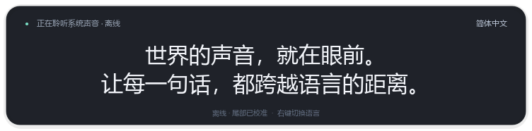

# 声屿 · SonoWeave

Windows 10 / 11 x64 的极简**离线实时翻译字幕**。只显示悬浮字幕；系统声音采集、语音识别、上下文翻译均在本机运行，无需账号或 API key。



## 直接使用

双击 `dist/SonoWeave/SonoWeave.exe`，或项目根目录的 `Start.bat`。请保留整个程序文件夹，包括 `_internal` 和 `models`。本次交付已附带两个模型，运行时无需网络，也不会自动下载或调用在线翻译。

- 右键字幕 → **翻译为**：选择目标语言，设置自动保存。
- 拖动字幕移动窗口；拖动右下角调整宽度。
- 字幕下方的“正在校准”表示暂定译文，随后会替换为修订版本；“已定稿”表示本次语音窗口结束。
- 右键 → **退出**。组件加载或音频异常时可右键重新连接。

支持简体中文、繁体中文、英语、日语、韩语、法语、德语、西班牙语、葡萄牙语、俄语、意大利语、阿拉伯语、印地语、泰语、越南语、印尼语、土耳其语、乌克兰语。源语言自动识别。不同语种和领域的准确率有差异。

## 离线模型

| 用途 | 模型 | 模型文件体积 | 推理方式 |
| --- | --- | --- | --- |
| 语音识别 | Whisper base 多语言版 | 约 148 MB，含分词文件 | faster-whisper / CTranslate2；CUDA FP16，或 CPU int8 |
| 翻译与上下文修订 | Qwen3-1.7B，Q4_K_M | 1,107,409,472 字节，约 1.03 GiB | llama.cpp；Vulkan GPU 或 CPU，关闭思考模式 |

选择 1.7B 的量化指令模型，是为了在约 1 GB 模型体积内保留上下文理解与修订能力。它不是经过本项目全面验证的专业领域翻译模型，不保证所有语种或专业术语的准确率。[Qwen 官方模型说明](https://huggingface.co/Qwen/Qwen3-1.7B)及[使用的量化权重](https://huggingface.co/unsloth/Qwen3-1.7B-GGUF)可供检查；权重版本固定在准备脚本中。

GPU 推理首次运行需要编译和预热，界面在此期间显示“模型加载中”。**启动准备时间与运行中的字幕延迟分别统计**。识别端仅在本机 CUDA 库实际可用时使用 CUDA；翻译端自动尝试 Vulkan，初始化失败时退回 CPU。仅有 CPU 也可以离线使用，速度取决于硬件。

## 延迟与校准

1. 每 50 ms 读取系统音频。约 0.9 秒的语音窗口开始首次识别；之后约每 0.55 秒提交一个包含当前句子完整音频的新窗口，不必等整句说完。
2. 启动时即开始采集音频，采集、识别和翻译分别在后台运行。**原文缓存持续增长**：新句子追加，当前句子的识别修订替换其末尾草稿；静音和分窗不会清空前文。缓存最多保留约 8000 字符或 96 段。
3. 每次从原文缓存取最近最多 3 段、约 640 字符构成翻译窗口，按原文顺序处理，同时提供每段前面的最多两段上下文（约 320 字符）。已翻译且原文、语言、上下文未变的段落直接复用，只对新增或被校准的末尾运行模型，避免整段反复推理积压。
4. **译文缓存持续追加**，通过原文段落编号保持对应关系；修订只替换对应段落，不反复追加同一句话。前面的译文继续留在内存中，窗口显示缓存末尾最多 4 行字幕，自动向后滚动。译文缓存也限制为约 8000 字符或 96 段。翻译待处理队列只保留原文缓存的最新快照，但缓存本身保留前文。
5. 连续静音约 350 ms 后确认当前识别窗口，识别继续等待新语音。连续讲话超过 15 秒时携带约半秒重叠音频进入下一窗，并在原文缓存去除明确来自该重叠的重复词，减少截断边界遗漏。超过 20 秒的停顿或源语言变化会隔断翻译上下文，原文缓存仍保留。切换目标语言会清空旧语言的译文缓存并重新翻译最近的原文窗口。
6. 检测中文字幕中的大段英文回显、短原文被扩写成整段上下文，以及长原文异常缩成几个字的情况，必要时改用更简洁的中文指令重试。旧片段暂时翻译失败时保留其原文和最近一次成功译文，让后续语音继续处理，避免某一句失败堵住整条字幕流。这些检查不能代替完整的语义准确性评估。0.3.1 移除了可能被小模型误当成答案的固定翻译示例。

这些时间是调度参数，并非总延迟承诺。首条字幕还需要识别和翻译耗时；暂定译文可能随着后续词语改变。小模型的上下文校准也可能判断错误。实测数据和测试条件见 [验证记录](artifacts/verification.md)。

## 声音与隐私

采集默认扬声器/耳机的 WASAPI 回环声音，不使用麦克风；默认输出设备变化后自动重连。默认设备上的浏览器、视频播放器和会议软件声音会一起采集。单独路由到其他输出设备的声音、独占音频及受保护媒体不保证可以采集。

运行时不联网，不保存录音、原文或字幕历史。上下文和翻译缓存均在内存中。语言设置及诊断日志位于 `%LOCALAPPDATA%/SonoWeave`；日志包含组件状态与延迟，不主动记录实际字幕。模型位于程序旁的 `models` 目录。`artifacts` 下的文字测试结果来自公开测试样例。

## 从源码安装

需要 64 位 Python 3.11 或 3.12。

1. 双击 `Install.bat` 安装依赖。此步需要网络。
2. 双击 `PrepareModels.bat` 准备两个模型。此步需要网络，只需执行一次；已有附带模型时无需再下载。
3. 双击 `Start.bat`。完成准备后可以断网运行。

```powershell
.venv\Scripts\python.exe main.py
.venv\Scripts\python.exe -m pytest -q
.venv\Scripts\python.exe tools\smoke.py
.venv\Scripts\python.exe tools\benchmark.py
.venv\Scripts\python.exe tools\benchmark.py --cpu
.venv\Scripts\python.exe tools\live_test.py --seconds 90
.venv\Scripts\python.exe main.py --preview
.venv\Scripts\python.exe main.py --screenshot artifacts\preview.png
```

`smoke.py` 会阻止 Python 网络连接，使用本地模型和公开测试语音验证真实离线识别、翻译及上下文词义消歧。若缺少测试语音，先执行 `tools/prepare_models.py --test-sample`。`benchmark.py` 按真实时间将该语音输入流式处理链路，不会向扬声器播放声音。`live_test.py` 则实际监听默认输出设备，验证两个缓存持续增长；不保存音频，会将测试时的原文、译文与界面诊断保存在被 Git 忽略的 `.cache/<label>-test` 下，发布程序不包含这些内容。`--preview` 与 `--screenshot` 显示示例字幕，不代表现场识别结果。

打包：运行 `powershell -ExecutionPolicy Bypass -File .\Build.ps1`，生成 `dist/SonoWeave`，同时复制两个模型。

可选环境变量：

| 变量 | 用途 |
| --- | --- |
| `SONOWEAVE_HOME` | 设置与日志目录 |
| `SONOWEAVE_MODEL` | 本地 CTranslate2 Whisper 模型目录 |
| `SONOWEAVE_TRANSLATE_MODEL` | 本地 Qwen3 GGUF 模型文件 |
| `SONOWEAVE_ASR_DEVICE` | `auto`（默认）或 `cpu` |
| `SONOWEAVE_TRANSLATE_DEVICE` | `auto`（默认）或 `cpu` |

模型准备程序可使用 `HF_ENDPOINT` 和 `HTTPS_PROXY`，桌面应用运行时不使用它们访问网络。技术参考：[SoundCard](https://soundcard.readthedocs.io/en/latest/)、[faster-whisper](https://github.com/SYSTRAN/faster-whisper)、[llama-cpp-python](https://github.com/abetlen/llama-cpp-python)。
