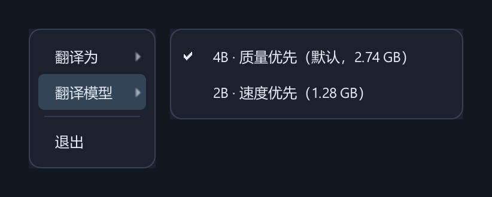

  

## 功能特征

- 监听默认扬声器或耳机的系统声音，自动识别源语言。
- 本地识别、翻译与上下文校准；模型下载后可离线使用。
- 默认 4B 模型，支持切换更快、更轻的 2B；支持多种目标语言。
- 仅显示字幕，支持拖动、缩放和右键设置。

## 环境配置

- Windows 10 / 11，或 Linux x86_64 桌面（PulseAudio / PipeWire）。
- 安装器自动准备 uv、Python 3.12 和依赖，无需预装 Python。
- 支持 GPU 加速，也可使用 CPU；首次下载模型需要网络和足够磁盘空间。

## 快速使用

1. **Windows 源码版**：双击 `Start.bat`；**Linux**：运行 `bash Start.sh`。环境未就绪时会先自动安装；Linux 安装系统库时可能要求 sudo 密码。
   **Windows 发布版**：直接打开 `SonoWeave.exe`，保留 `_internal`。
2. 首次启动自动下载所需模型，完成后播放外语音频即可。
3. 右键字幕选择翻译语言或 **4B / 2B** 模型，设置自动保存。

## 问题解决

- **没有字幕**：确认音频输出到系统默认设备，且未静音；异常时右键重新连接。
- **Linux 启动或采集失败**：检查 [音频服务与桌面依赖](docs/linux.md#问题解决)。
- **启动慢**：首次下载和模型预热需要时间，请留意进度。
- **环境安装失败**：检查网络与磁盘空间，重跑 `Install.bat` / `bash Install.sh`；更多说明见 [安装文档](docs/installation.md)。
- **字幕停滞**：右键重新连接；性能不足时切换到 2B。若提示旧任务未退出，请关闭程序后重开。
- **下载失败**：检查网络后右键重试，已有下载进度会保留。
- **译文不准**：专名、习语仍可能错译；暂定字幕会随后文修订。

更多配置、实现原理与开发说明见 [文档](docs/README.md)。

[MIT 许可证](LICENSE) · [第三方许可](THIRD_PARTY.md)
